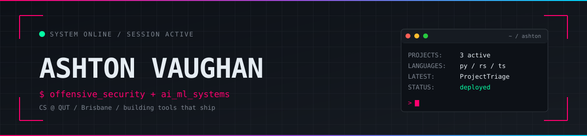
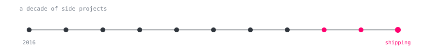

  

---

### `>` ./about

It started at 9, guessing the passwords on my parents' devices so I could play games. Still at it: 18 now, studying IT at QUT and hunting on HackerOne. Most of what I ship is security and AI tooling - an autonomous bug-bounty agent, an authorization-first LLM red-team framework, a Burp-to-MCP bridge, a hardware-agnostic LLM inference engine, and a browser runtime built for AI agents.

`offensive security` &nbsp;·&nbsp; `applied ml` &nbsp;·&nbsp; `agent systems` &nbsp;·&nbsp; `systems programming`

---

### `>` ./stack

**offense**  &nbsp;
 &nbsp;
 &nbsp;
 &nbsp;
 &nbsp;
 &nbsp;

**ai / ml**  &nbsp;
 &nbsp;
 &nbsp;
 &nbsp;
 &nbsp;
 &nbsp;
 &nbsp;

**systems**  &nbsp;
 &nbsp;
 &nbsp;
 &nbsp;
 &nbsp;
 &nbsp;
 &nbsp;

**ops**  &nbsp;
 &nbsp;
 &nbsp;
 &nbsp;
 &nbsp;
 &nbsp;

---

### `>` ./signal

---

### `>` ./recent

<!-- RECENT_START -->

- `2026-11-23` &nbsp; [exo-h1-submit](https://github.com/AshtonVaughan/exo-h1-submit) &nbsp; exo-h1-submit: single-file HackerOne report client
- `2026-10-19` &nbsp; [Hacking](https://github.com/AshtonVaughan/Hacking) &nbsp; 100 sub-branches per technique file (rows 101-200), 187600 new rows
- `2026-10-11` &nbsp; [fieldwork-ctf](https://github.com/AshtonVaughan/fieldwork-ctf) &nbsp; Version game scripts to prevent stale browser assets
- `2026-09-30` &nbsp; [adlottery](https://github.com/AshtonVaughan/adlottery) &nbsp; Rebuild as The Weekly Pot, hosted on GitHub Pages (#2)
- `2026-08-24` &nbsp; [DemandLab](https://github.com/AshtonVaughan/DemandLab) &nbsp; Update Pages workflow actions
- `2026-07-16` &nbsp; [Nerve](https://github.com/AshtonVaughan/Nerve) &nbsp; docs: mark project as non-working and unmaintained

<!-- RECENT_END -->

---

<code>responsible disclosure only / AEST / always learning</code>

